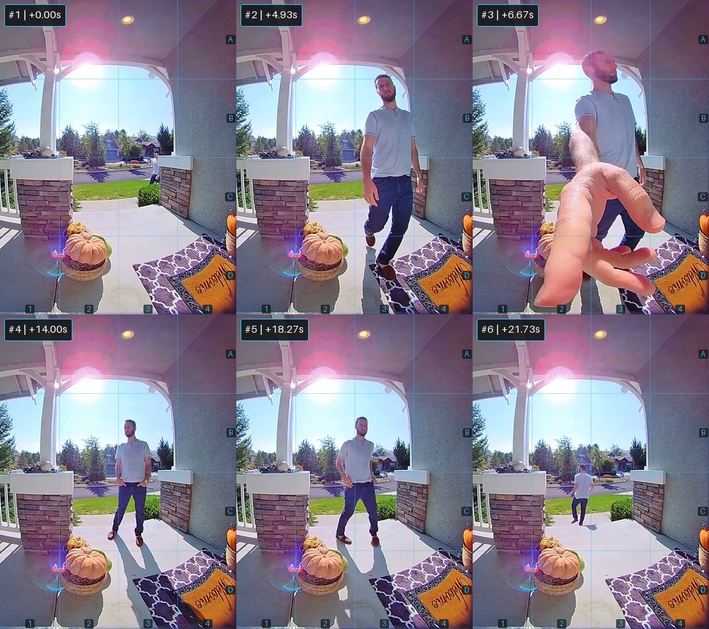

# vlm-sieve: Python Library for Vision-Language Model (VLM) Video Preprocessing (v0.3.0)

[](https://pypi.org/project/vlm-sieve/)
[](https://pypi.org/project/vlm-sieve/)
[](https://opensource.org/licenses/MIT)

> **PyPI Package:** `pip install -U vlm-sieve` | **Python Import:** `from vlmsieve import SieveConfig, VideoSieve`

**Local-First, Zero-GPU Spatial-Temporal Video Gatekeeper & `28px`-Aligned Storyboard Packer for Vision-Language Models (VLMs)**

`vlm-sieve` sits in front of Vision-Language Models (`Gemini`, `GPT-4o`, `Claude`, `Qwen2.5-VL`, `Llama-Vision`, `InternVL`) to filter out dead air, merge fragmented motion bursts into coherent episodes, crop active Regions-of-Interest (ROIs) with generous context padding, and pack peak-preserving keyframes into dimension-aligned spatial-temporal storyboards.

---

## What's New in v0.3.0 (Local VLM & `NaViT` Patch Optimization)

1. **One-Line VLM Target Profiles (`target_vlm` / `--target-vlm`):** Built-in presets (`"gemini"`, `"gpt-4o"`, `"qwen-vl"`, `"local-7b"`) that automatically tune tile dimensions, ViT patch stride alignment, gutter spacing, and coordinate overlay density.
2. **28px NaViT Patch-Stride Alignment (`patch_align=28`, `gutter_px=0`):** Snaps tile and canvas dimensions to exact multiples of `28px` (`448px` = 16x28 on `qwen-vl`, `336px` = 12x28 on `local-7b`) so local dynamic-resolution ViTs (`Qwen2.5-VL` on vLLM / Ollama) ingest storyboards with **zero secondary resizing**—cutting local patch tokens and FP16 KV-cache VRAM by another **52% to 73.5%** over `v0.2.1`.
3. **Adaptive Grid Sizing (`adaptive_grid=True`):** Dynamically selects `1x1`, `1x2`, `1x3`, `2x2`, or `2x3` layouts based on the episode's keyframe count so short motion bursts never emit blank `"NO FRAME"` dead tiles.
4. **Outer-Border Axis Ticks (`spatial_grid_style="axes"`):** Replaces the 96 interior `A1..D4` cell text badges (`16 cells x 6 tiles`) with **8 clean outer-border ruler ticks** (`A..D` along the right edge, `1..4` along the bottom edge), keeping the center of every tile 100% unobstructed and preventing OCR distraction on 3B/7B models.
5. **Discrete Tile Export (`event.get_cropped_tiles()`):** Exports the individual ROI-cropped keyframes as a `list[PIL.Image.Image]` for multi-image local VLM endpoints.
6. **Multi-Provider Token & KV-Cache Telemetry:** `sieve.get_savings_report()` and `event.provider_token_estimates()` calculate exact `gemini_storyboard_tokens`, `gpt4o_storyboard_tokens`, `qwen_vl_patch_tokens`, `qwen7b_kv_cache_mb`, and `qwen7b_kv_cache_saved_mb`.

### Core Engine Foundations (from v0.2.1)

* **Bit-Stream Frame Striding (`sample_fps=10.0`) + Lazy RGB Caching:** Uses `cap.grab()` at the demuxer level to skip intermediate frames without decoding pixel buffers, cutting local CPU preprocessing time by **60%+**.
* **Episode Merging (`merge_gap_sec=6.0`) + Bridge Frames:** Combines adjacent motion bursts separated by brief pauses and retains ~2 FPS bridge frames across merged gaps so multi-second interactions emit a single unified storyboard.
* **Micro-Motion Circular Pre-Roll Buffer (`pre_roll_sec=3.0`, `pre_roll_min_score=0.0025`):** Captures subtle early approaches (e.g., distant sidewalk footsteps) before the main foreground threshold is crossed.
* **Hybrid Peak-Preserving Keyframe Sampler:** Prevents `<1.5s` duplicate frames while preserving transient action peaks (such as a 1-second doorbell button press).
* **Global Camera-Disturbance Classifier (`suppress_disturbances=True`):** Automatically identifies full-frame camera shake or auto-exposure flashes, logs the timestamp in `summary.json`, and suppresses redundant empty-room storyboard images.
* **Both-Axis Tile Clamping & Context Padding (`roi_padding_ratio=0.35`):** Clamps both `max(width, height)` per tile and preserves surrounding scene context around objects.

---

## VLM Target Profiles (`target_vlm` / `--target-vlm`)

| Profile | Max Grid | `adaptive_grid` | `tile_max_dim` | `patch_align` | `gutter_px` | `spatial_grid_style` | Best For |
| :--- | :--- | :--- | :--- | :--- | :--- | :--- | :--- |
| **`"gemini"`** | `2x3` | `False` | `640px` | `None` | `4px` | `"cells"` (interior `A1..D4`) | Gemini 2.5 / 3.8 Flash & Pro |
| **`"gpt-4o"`** | `2x3` | `True` | `512px` | `None` | `0px` | `"axes"` (outer border ticks) | GPT-4o / GPT-4.1 (512x512 tiles) |
| **`"qwen-vl"`** | `2x3` | `True` | `448px` (16x28) | `28px` | `0px` | `"axes"` (outer border ticks) | Qwen2.5-VL-7B / 32B / 72B (`NaViT`) |
| **`"local-7b"`** | `2x3` | `True` | `336px` (12x28) | `28px` | `0px` | `"axes"` (outer border ticks) | Edge GPUs, 3B/7B local VLMs |

---

## Real-World Provider-Counted Gemini & Qwen2.5-VL Benchmarks

Measured using provider-reported `usage_metadata.prompt_token_count` on **Gemini 3.8 Flash** and exact **`Qwen2.5-VL` (`28x28` NaViT patch)** / **FP16 KV-Cache** math across real security footage (maintaining **100% event and object recall**):

### 1. 5m 22s Ring Home Security Footage (`1280x720` @ 30 FPS, 9,658 frames, 4 active episodes)

| Pipeline / Profile | Emitted Payload / Canvas | Provider Gemini Tokens | Qwen2.5-VL Patch Tokens | Qwen-VL Reduction vs `v0.2.1` | Qwen2.5-VL-7B FP16 KV Cache | Latency / CPU Time |
| :--- | :--- | :--- | :--- | :--- | :--- | :--- |
| **Direct Video Upload** | Full `.webm` (`322s`, `1280x720`) | `29,403` (Baseline) | `3,851,120` (at 10 FPS) | — | `210,608.1 MB` | `44.22s` (`18.3s` upload + `25.9s` API) |
| **`v0.2.1` (`gemini`)** | 4 Storyboards (`1936x732`, `28px`: No) | `4,823` (`83.60%` saved) | `9,776` | Baseline | `534.62 MB` | `17.08s` CPU + `22.93s` API |
| **`v0.2.1` (Visual + Audio)** | 4 Storyboards + `1.2 MB` `.mp3` | `12,925` (`56.04%` saved) | `9,776` (visual) | Baseline | `534.62 MB` | `18.34s` CPU |
| **`v0.3.0` (`qwen-vl`)** | 4 Storyboards (`1344x504`, `28px`: **Yes**) | **`4,485` (`84.75%` saved)** | **`4,608`** | **`-52.9%`** | **`252.00 MB`** | `16.26s` CPU + **`11.64s` API** |
| **`v0.3.0` (`local-7b`)** | 4 Storyboards (`1008x392`, `28px`: **Yes**) | **`4,426` (`84.95%` saved)** | **`2,592`** | **`-73.5%`** | **`141.75 MB`** | `16.26s` CPU + `18.85s` API |

### 2. 40s Vivint Doorbell Footage (`720x720` @ 15 FPS, 600 frames, 1 active episode)

| Pipeline / Profile | Emitted Payload / Canvas | Provider Gemini Tokens | Qwen2.5-VL Patch Tokens | Qwen-VL Reduction vs `v0.2.1` | Qwen2.5-VL-7B FP16 KV Cache | End-to-End Latency |
| :--- | :--- | :--- | :--- | :--- | :--- | :--- |
| **Direct Video Upload** | Full `.mp4` (`40s`, `720x720`) | `3,659` (Baseline) | `202,800` (at 10 FPS) | — | `11,090.6 MB` | `19.20s` |
| **`v0.2.1` (`gemini`)** | 1 Storyboard (`1408x1292`, `28px`: No) | `1,292` (`64.69%` saved) | `2,397` | Baseline | `131.09 MB` | `11.62s` (`39.5%` faster) |
| **`v0.2.1` (Visual + Audio)** | 1 Storyboard + `157 KB` `.mp3` | `2,346` (`35.88%` saved) | `2,397` (visual) | Baseline | `131.09 MB` | `16.04s` (`16.5%` faster) |
| **`v0.3.0` (`qwen-vl`)** | 1 Storyboard (`1008x896`, `28px`: **Yes**) | **`1,205` (`67.07%` saved)** | **`1,152`** | **`-51.9%`** | **`63.00 MB`** | **`9.14s` (`52.4%` faster)** |
| **`v0.3.0` (`local-7b`)** | 1 Storyboard (`756x672`, `28px`: **Yes**) | **`1,205` (`67.07%` saved)** | **`648`** | **`-73.0%`** | **`35.44 MB`** | **`9.68s` (`49.6%` faster)** |

---

## Sample Videos & Verifiable Benchmark Artifacts

Want to reproduce the benchmarks or inspect the generated storyboards and raw VLM responses?

### 1. Sample Input Videos (`assets/sample-videos/`)
* [Ring Shovel Identification (`.webm`)](assets/sample-videos/ring-shovel-identification.webm)
* [Vivint Doorbell Sample (`.mp4`)](assets/sample-videos/vivint-doorbell-sample.mp4)

### 2. Generated Storyboards & JSON Verification Reports (`benchmarks/v030_results/`)
* **Provider-Counted VLM Accuracy & Token Verification JSON:** [`benchmarks/v030_results/v030_accuracy_verification.json`](benchmarks/v030_results/v030_accuracy_verification.json)
* **Ring Security Profile Comparison & Storyboards:** [`benchmarks/v030_results/ring_security/`](benchmarks/v030_results/ring_security/)
* **Vivint Doorbell Profile Comparison & Storyboards:** [`benchmarks/v030_results/vivint_doorbell/`](benchmarks/v030_results/vivint_doorbell/)

**Sample `v0.3.0` (`qwen-vl` Profile — `1008x896`, `28px`-Aligned, Outer-Border Axis Ticks):**


---

## Installation

```bash
pip install -U vlm-sieve
```

---

## Quickstart (Python API)

### Option A: Using `v0.3.0` Target Profiles (`qwen-vl`, `local-7b`, `gpt-4o`, `gemini`)

```python
from vlmsieve import SieveConfig, VideoSieve

# Optimize for Qwen2.5-VL (448px tiles, 28px NaViT alignment, 0px gutter, outer-border axis ticks)
sieve = VideoSieve("security_footage.mp4", config=SieveConfig(target_vlm="qwen-vl"))
events = sieve.process_video()

for ev in events:
    print(f"Event {ev.event_id}: {ev.start_time_sec:.2f}s - {ev.end_time_sec:.2f}s")
    print("  Grid & Token Estimates:", ev.provider_token_estimates())
    crops = ev.get_cropped_tiles()  # Discrete ROI-cropped keyframe PIL Images

report = sieve.get_savings_report()
print(f"Qwen-VL Patch Tokens : {report.qwen_vl_patch_tokens:,}")
print(f"Qwen2.5-VL-7B KV VRAM: {report.qwen7b_kv_cache_mb} MB (Saved {report.qwen7b_kv_cache_saved_mb:,.1f} MB)")
```

### Option B: Custom Parameters & Directory Export

```python
from vlmsieve import VideoSieve

sieve = VideoSieve(
    source="security_footage.mp4",
    sample_fps=10.0,
    pre_roll_sec=3.0,
    merge_gap_sec=6.0,
    tile_max_dim=640,
    suppress_disturbances=True,
)

events = sieve.process_video_to_dir("./sieve_output")
report = sieve.get_savings_report()

for ev in events:
    print(
        f"Event {ev.event_id}: {ev.start_time_sec:.2f}s - {ev.end_time_sec:.2f}s | "
        f"Keyframes: {ev.keyframe_times_sec} | Size: {ev.storyboard_pil.size}"
    )
```

---

## Command-Line Interface (CLI)

```bash
# Default Gemini profile
vlmsieve ./input_video.mp4 -o ./sieve_output --pre-roll-sec 3.5 --merge-gap-sec 6.0

# Qwen2.5-VL profile (448px tiles, 28px patch-aligned, adaptive grid, outer-border axis ticks)
vlmsieve ./input_video.mp4 -o ./sieve_output_qwen --target-vlm qwen-vl

# Compact 3B/7B local profile (336px tiles, 28px patch-aligned, adaptive grid, outer-border axis ticks)
vlmsieve ./input_video.mp4 -o ./sieve_output_7b --target-vlm local-7b

# Run as a Python module
python -m vlmsieve ./input_video.mp4 -o ./sieve_output --target-vlm gpt-4o
```

---

## License

MIT License
